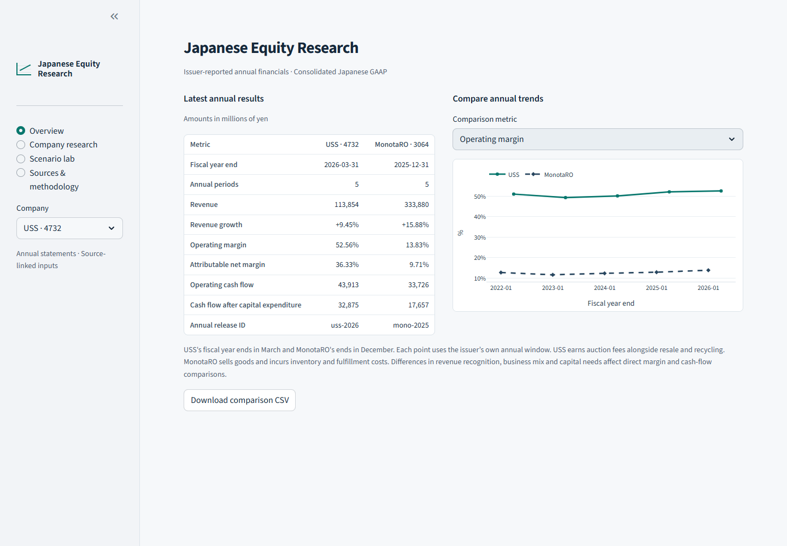
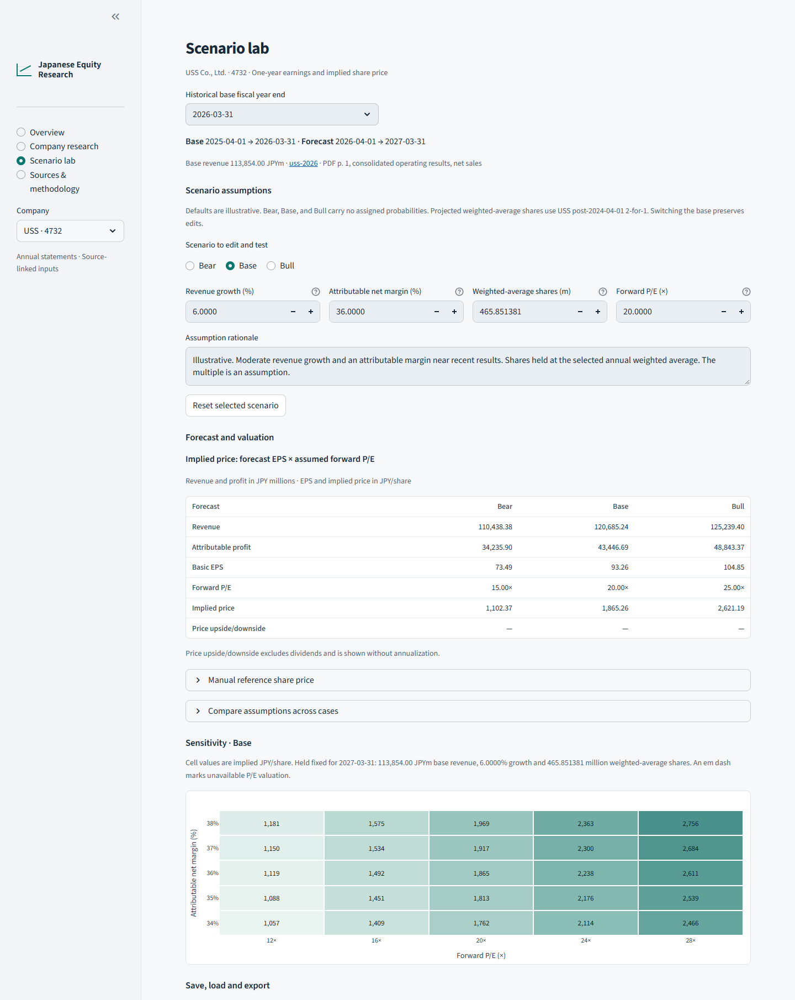

# Japanese Equity Research

An annual equity research workspace for Shane Twomey’s company research and stock pitches. It asks how a company makes money, how its financial results have changed, what drives earnings and valuation, and what would weaken the investment thesis.

| Company | Code | Business | Fiscal year ends bundled |
| --- | --- | --- | --- |
| USS Co., Ltd. | 4732 | Used-vehicle auctions, resale and recycling | 2022-03-31 through 2026-03-31 |
| MonotaRO Co., Ltd. | 3064 | Online distribution of indirect industrial materials | 2021-12-31 through 2025-12-31 |

Each period uses consolidated Japanese GAAP and the current-year column of an issuer release. The [source registry](data/sources.json) identifies documents and publication and retrieval dates. The [line-item ledger](data/facts.csv) preserves original values, units, PDF locators and adjustments. Source access was checked on 2026-11-17. USS ends in March and MonotaRO ends in December.

## Run locally

Use **64-bit Python 3.13**. The app was exercised with Python 3.13.15 on Windows. Installing packages requires access to PyPI or a local mirror. After installation, the app uses local CSV and JSON files and needs no API keys or internet connection.

From the repository root, on Windows PowerShell:

~~~powershell
py -3.13 -m venv .venv
.\.venv\Scripts\python.exe -m pip install -r requirements-dev.txt
.\.venv\Scripts\streamlit.exe run app.py
~~~

On macOS or Linux:

~~~bash
python3.13 -m venv .venv
source .venv/bin/activate
python -m pip install -r requirements-dev.txt
streamlit run app.py
~~~

The terminal prints the local URL. With an activated environment on either platform, the launch command is **streamlit run app.py**. For app use alone, install from **requirements.txt**.

## Research workflow

1. **Overview** compares the latest annual results and charts growth, margins and cash flow.
2. **Company research** explains the business, charts annual financials and exposes reported values and PDF pages. Edit the thesis, supporting evidence, catalysts, risks and invalidation criteria here.
3. **Scenario lab** lets you choose a base fiscal year, edit Bear, Base or Bull, and compare forecasts and implied prices. Use the same case control to change the sensitivity grid. Changing base years preserves edits, including projected shares. Reset restores the selected case using the selected base's weighted-average shares.
4. **Save, load and export**, inside Scenario lab, saves or restores the selected company's notes and assumptions as JSON. There are also scenario and sensitivity CSVs and a printable offline HTML report. Press Enter or leave the field to commit edits before downloading. Browser session edits can be carried to another session through the JSON file.
5. **Sources & methodology** shows source dates, EPS reconciliation and conventions. **Company research** offers annual financials and line-item provenance CSVs.

[Open the printable USS example report](docs/example-uss-report.html). It uses bundled financial statements and illustrative assumptions, with the manual reference price left blank.

## Run the checks

Windows PowerShell:

~~~powershell
.\.venv\Scripts\python.exe -m pytest
.\.venv\Scripts\python.exe -m ruff check .
.\.venv\Scripts\python.exe -m ruff format --check .
~~~

macOS/Linux in an activated environment:

~~~bash
python -m pytest
python -m ruff check .
python -m ruff format --check .
~~~

The [GitHub Actions workflow](.github/workflows/checks.yml) runs the same checks on Python 3.13. Tests cover units, source references, missing data, period alignment, share basis, EPS, loss cases, company switching, reset, save/load and exports. The hand check starts with JPY 100,000 million revenue and returns JPY 110,000 million revenue, JPY 11,000 million attributable profit, JPY 110 EPS, JPY 2,200 implied price and 10% upside to a JPY 2,000 reference.

## Repository guide

- [app.py](app.py) is the Streamlit interface. [research/](research/) contains the independent data loader, financial model, session schema, charting and export code.
- [data/](data/) holds the original and normalized figures, annual periods, company profiles and sources.
- [Methodology](docs/methodology.md) explains the calculations and coverage. [Data update guide](docs/data-update.md) documents how to add a fiscal year or issuer.

Business descriptions are paraphrased from [USS investor relations](https://www.ussnet.co.jp/en/ir/individual/business/index.html) and [MonotaRO investor relations](https://corp.monotaro.com/en/ir/shareholders/shareholders_01.html). The dataset contains annual results and uses one forward P/E method. Management guidance, consensus and market prices are outside the bundled data.
